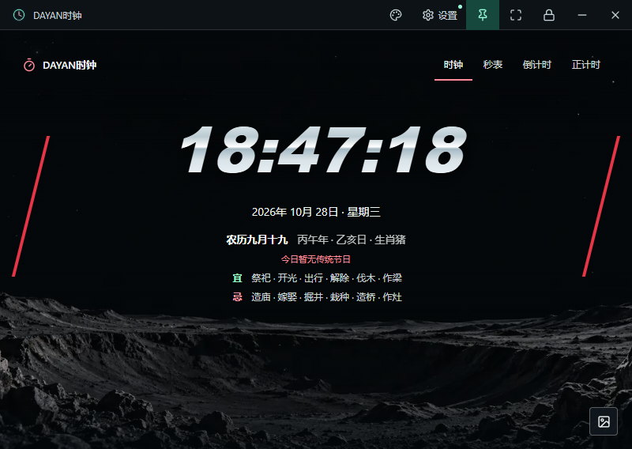
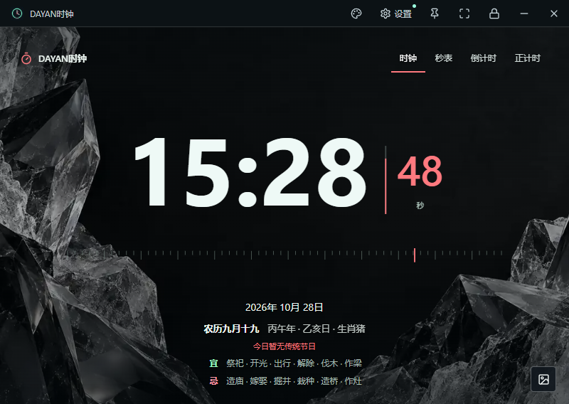
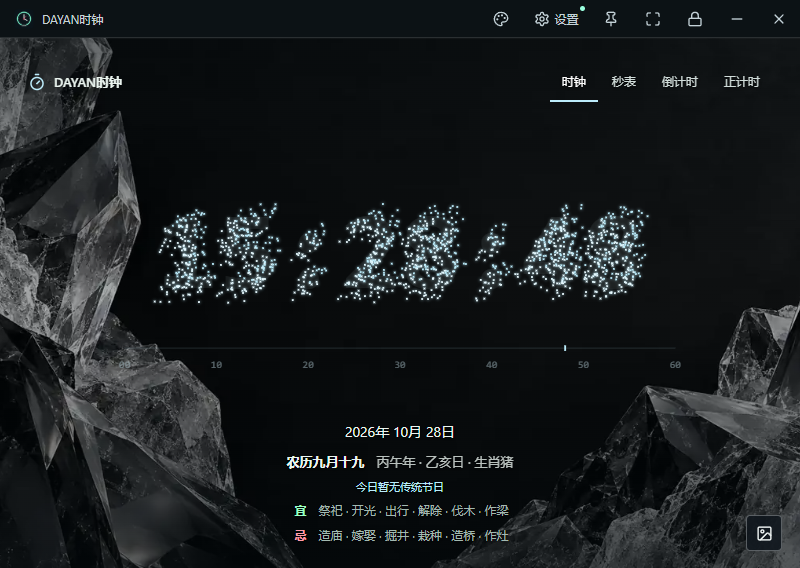
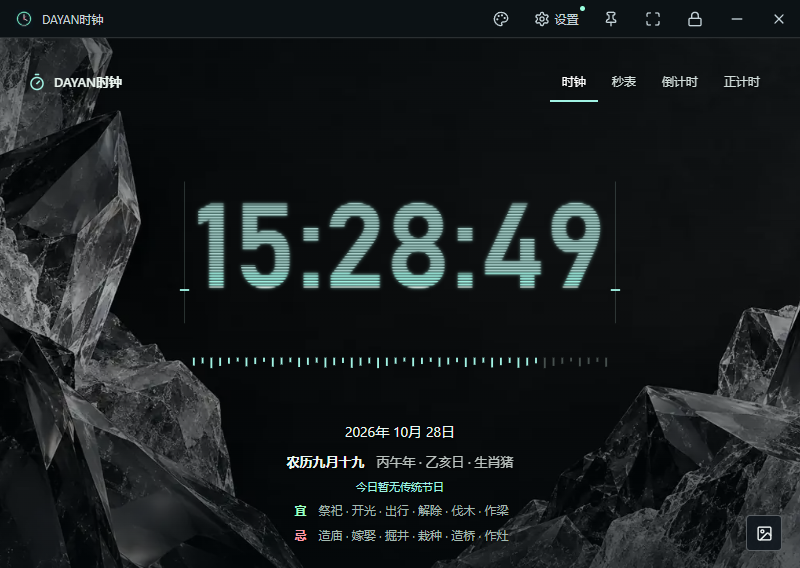
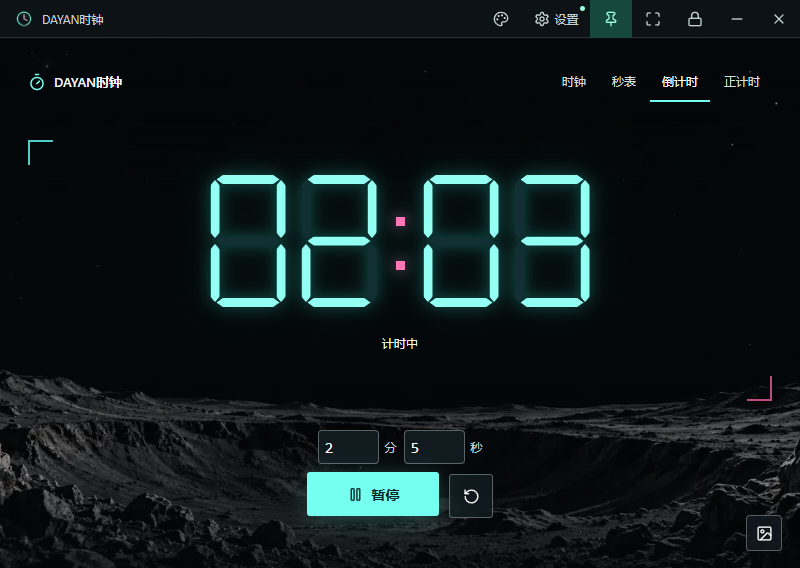
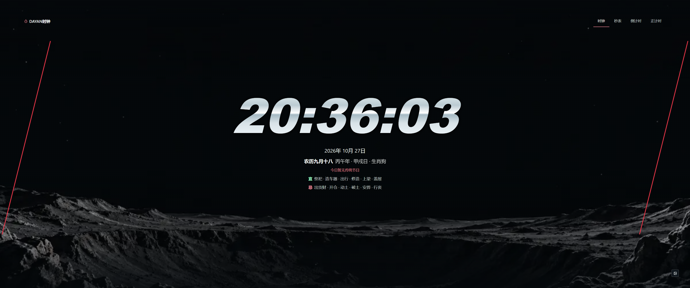
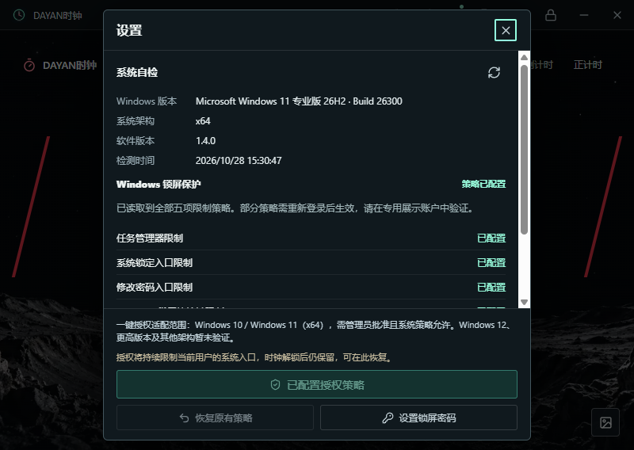
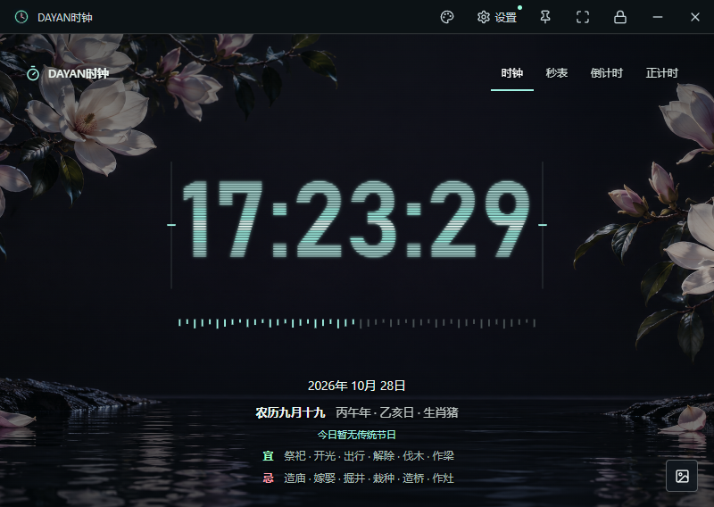

# DAYAN桌面

用于培训展示、直播计时和桌面屏保的离线桌面工具。打开即显示电脑本地时间，可切换秒表、倒计时和正计时；提供十四种显示样式、二十七款本地背景（含五种黑客动态壁纸和两款原创骑行动画）、日期与黄历，以及密码锁定展示模式。

当前版本：**1.6.22**。本仓库与 Release 已设为公开，代码、素材、文档和 Windows 安装包可直接访问。

[下载安装包](https://github.com/jyan5334-lab/dayan-clock/releases/latest) · [使用说明](docs/user-guide.md) · [部署与构建](docs/deployment.md) · [换电脑与远程维护](docs/maintenance.md) · [更新记录](CHANGELOG.md)



## 功能与界面

| 功能 | 当前行为 |
| --- | --- |
| 时钟 | 默认首页，显示本机时分秒、年月日、星期、农历、节日节气与宜忌 |
| 秒表 | 启动、暂停、继续和重置，显示小数秒 |
| 倒计时 | 设置分钟与秒数，支持暂停、继续和归零 |
| 正计时 | 从零累计，支持暂停、继续和重置 |
| 经典样式 | 霓虹矩阵、液态铬金、机械黑曜、量子光环、赛博终端 |
| 新增九款 | 巨幕极简、星舰中枢、星尘聚时、电路脉冲、故障电压、酸性涂鸦、光速轨迹、三体星轨、光谱脉冲 |
| 二十张壁纸 | 保留原有十张，新增十个主题；全部本地提供，断网可用，当前为静态图片 |
| 动态背景 | 独立分类提供鹈鹕骑行、海边日落骑行；保留原始动画，离线播放，多屏分别适配 |
| 窗口与全屏 | 四角等比例缩放、置顶、全屏适配、顶部栏随鼠标移动暂时显示 |
| 密码锁定 | 4 至 16 位数字密码；主屏黄历下方点击解锁，主屏居中密码面板、数字键盘及系统键盘入口；Windows 原生拦截普通按键和 Win 键，解锁后释放 |
| Windows 设置 | 启动自检、版本架构识别、一键引导授权；逐项恢复授权前的策略并复检，成功后支持重新授权 |
| 设置菜单 | 一键授权、显示设置、开机自启动、关于我们和窗口层级 |
| 更新检查 | 启动自动检查；支持现在更新、今日不再提醒和取消，手动检查始终可用 |
| 系统托盘 | 全屏时常驻托盘；支持设置、切换样式、切换背景、回到小窗口和退出 |
| 本地保存 | 保存样式、背景、倒计时目标、暂停计时值、显示偏好、开机自启动和窗口设置 |

安装版开启自启动时优先配置当前用户的登录任务，无需保存账户密码；配置失败保留原启动项。关闭自启动和卸载会清理登录任务。桌面加载会等待 Explorer 图标层就绪，并持续维护图标在背景上方；程序就绪耗时记录在本地偏好中，真实开机时长仍取决于设备和系统启动环境。

### 新增样式

点击顶部调色盘，在“新增样式”中选择。九款样式均支持时钟、秒表、倒计时与正计时，切换样式不会重置正在运行的计时。

| 巨幕极简 | 星尘聚时 | 光谱脉冲 |
| --- | --- | --- |
|  |  |  |

### 倒计时



### 全屏与黄历

全屏按屏幕实际宽高布局；普通窗口保持比例。1.6.6 修复了未锁定置底全屏两侧残留原生边框的问题，壁纸显示区与当前显示器四边重合，分辨率、缩放比例或显示器连接发生变化后会重新适配。停止移动鼠标后，顶部栏自动隐藏。日期显示星期，黄历在本地计算，不需要联网；是否显示黄历及右上角四种模式文字可在设置中分别控制。

未锁定且“窗口层级 → 未锁定全屏”选择“置底”时，时钟作为桌面背景，Explorer 的桌面图标、文件、任务栏及应用窗口保持在上方；空白处右键使用 Windows 原生的刷新、新建等菜单。设置中的“多屏显示范围”可以选择当前显示器或全部显示器，全部显示器会按 Windows 虚拟桌面范围铺开，支持左右扩展、上下排列和不同分辨率组合；选择全部显示器后，背景覆盖所有屏幕，时间、日期、农历和黄历只在 Windows 主显示器的居中靠上区域显示，副屏只显示背景。鼠标移到桌面顶部边缘会出现独立操作栏，可上锁或返回窗口；设置、样式和壁纸按钮会返回普通窗口配置。桌面上方被其他应用占用时不会抢占该应用的顶部。



### 设置菜单与更新

顶部“设置”始终是未锁定状态下的入口，菜单包含“一键授权”“显示设置”“开机自启动”“关于我们”和“窗口层级”。安装或从旧版升级后首次启动自动打开设置；每次启动仍会检测系统与策略。关于我们中标注归属公司为昆明迅琰网络科技有限公司。

应用全屏后会在 Windows 系统托盘中持续运行。右键托盘图标可依次打开“设置”“切换样式”“切换背景”，或选择“最小化（回到窗口）”退出全屏；“退出”会关闭程序。开机自启动默认开启，登录 Windows 后会恢复上次选择的样式、背景和全屏桌面状态。锁屏期间托盘菜单保持禁用，解锁后恢复可用。

界面就绪后自动通过 GitHub API 和公开更新清单检查版本；失败时自动重试，网络恢复时再次检查。发现新版本后打开独立更新窗口，即使程序作为置底壁纸或在托盘中运行，也不会被桌面遮挡或改变壁纸尺寸。提示提供“现在更新”“今日不再提醒”和“取消”：今日暂停按本机自然日保存，次日恢复自动提醒；取消仅关闭本次运行的提示，下次启动仍可提醒。设置中的手动检查不受暂停影响。更新器探测直连与 Windows 系统代理通道，最多合并 10 个可信地址，以 8 路、2 MB 分段下载。失败分段自动换地址并重试，重新点击更新或重开程序时保留并复检已完成分段，显示字节进度和传输速度。下载和安装交接期间暂停关闭操作，失败后可重试或关闭。最终 SHA-256 校验通过后等待安装辅助程序就绪，再退出旧版本、显示安装进度并重启。安装失败保留安装包和日志，尝试重新打开原程序。

GitHub 的跨境链路仍可能波动，客户端优化不能保证所有中国网络的下载速度。发布方可用自有对象存储/CDN，通过 `DAYAN_UPDATE_MANIFEST_URL` 的 `mirrorUrls` 提供可信镜像；程序不预置未知第三方代理，不内置 GitHub Token，不关闭 TLS 或文件校验。

系统级授权会识别 Windows 版本类型。Windows 10/11 Enterprise、Education、IoT Enterprise 可在管理员批准后启用 Keyboard Filter 并配置 `Ctrl+Alt+Del` 规则；首次开启需要重启后继续配置，管理员筛选范围变化需要重新登录。家庭版、专业版不能通过 UAC 获得这个仅限特定版本的组件。设置分别显示基础策略、安全序列规则和等待重启状态，并提供恢复备份入口。系统规则为持续的设备配置，时钟解锁不会自动撤销；详见 [系统锁定范围](docs/windows-kiosk.md)。

**1.6.2 / 1.6.3 用户升级提示：** 旧版安装交接可能在下载完成后直接退出。请手动下载并安装 1.6.4 一次；新辅助程序安装后，后续更新才会使用修复后的交接流程。



### 壁纸预览

右下角图片按钮可选择全部二十张壁纸；选择面板支持滚动，小窗口也可访问完整列表。最新十张 PNG 原图实测为 **1672×941**，采用居中等比例覆盖，**不属于原生 4K / 8K 壁纸**。屏幕尺寸适配与图片原生清晰度是两回事。完整主题、分辨率与生成来源见 [壁纸说明](docs/wallpapers.md)。



#### 新增十个主题

| 银河穹顶 | 钛银机库 |
| --- | --- |
|  |  |
| 深海遗迹 | 极夜雪境 |
|  |  |
| 翡翠秘境 | 玫瑰星纱 |
|  |  |
| 月下花庭 | 流光琉璃 |
|  |  |
| 金曜沙海 | 雨夜霓城 |
|  |  |

#### 原有十张

| 暗夜山峦 | 寂静月面 |
| --- | --- |
|  |  |
| 午夜海潮 | 混凝土秘境 |
|  |  |
| 熔岩余烬 | 雨后深林 |
|  |  |
| 绯红绸幕 | 冰晶棱镜 |
|  |  |
| 银月沙丘 | 雨夜都市 |
|  |  |

## 安装要求

| 项目 | 要求或范围 |
| --- | --- |
| 已提供安装包 | Windows 10 / Windows 11，x64 |
| 使用时依赖 | 无需 Node.js、浏览器插件或服务器 |
| 网络 | 安装、运行与本地黄历不依赖网络；下载和维护代码需要网络 |
| 管理员权限 | 日常运行不申请管理员；修改 Windows 策略时由用户批准 UAC |
| 实机验证 | Windows 11 专业版 x64；Windows 10 尚未实机验收 |
| 其他平台 | Windows 12 等未来版本及 ARM64 授权未验证；macOS 仅预留构建配置 |

1. 打开公开仓库的 [Releases](https://github.com/jyan5334-lab/dayan-clock/releases)。
2. 下载最新 Release 的 `DAYANClock-Setup-1.6.14-x64.exe`，运行后选择安装目录。
3. 从桌面或开始菜单启动，首次打开可在设置中确认系统版本与策略状态。
4. 核对设置页中的软件版本。升级时先退出旧程序，再运行新安装包。

安装包当前未做 Windows 代码签名，系统可能显示“未知发布者”。每个版本附带 `SHA256SUMS-1.6.1.txt`，校验方法见 [部署说明](docs/deployment.md#安装包校验)。

## 开发与构建

建议使用 Windows x64、Git 和 Node.js 24（含 npm）；本次构建使用 Node.js 24.19.0。依赖版本由 `package-lock.json` 锁定，首次安装依赖与下载打包工具需要网络。

```sh
git clone https://github.com/jyan5334-lab/dayan-clock.git
cd dayan-clock
npm ci
npm run check
npm start
```

生成 Windows x64 安装包：

```sh
npm run dist:win
```

输出在本机 `release/`。该目录不进入 Git 历史，正式安装包和源码压缩包通过 GitHub Release 保存。`npm run check` 检查源码语法、资源与文档链接，不代替实际桌面交互验收。

macOS 需在 Mac 或 macOS 构建环境执行 `npm ci` 和 `npm run dist:mac`。当前未交付或验证 Mac 安装包；正式分发需要另行配置签名和公证。详见 [部署与构建](docs/deployment.md)。

## 源码结构

```text
desktop/           Electron 主进程、IPC、窗口缩放和 Windows 打包
renderer/          计时逻辑、样式、背景列表、黄历与桌面交互
assets/            二十张壁纸、素材清单、应用图标和第三方许可证
scripts/           Windows 策略授权/恢复，以及原始素材工具
tools/             可在新电脑直接运行的源码检查
docs/              使用、部署、维护、验收与版本说明
.github/           问题反馈模板
index.html         应用入口
package-lock.json  固定依赖版本
```

## 锁屏与数据

应用密码保存在本机用户目录中，采用加盐 PBKDF2 哈希；不读取或更改 Windows 登录密码。普通应用无法拦截 `Ctrl+Alt+Delete`，1.6.8 可在支持的 Windows 版本上由管理员批准配置系统 Keyboard Filter。**用户策略和系统规则在解锁和退出程序后仍然保留**，可在设置中恢复；读取到规则不等于完成实体设备安全验收。详见 [Windows 锁定说明](docs/windows-kiosk.md)。

本地设置默认位于 `%APPDATA%\DAYAN时钟\preferences.json`，卸载时保留。GitHub 保存程序和素材，不会自动备份个人设置、密码或系统策略。换电脑时按 [迁移说明](docs/maintenance.md) 操作，旧电脑的策略备份不可在新电脑还原。

动态壁纸当前尚未作为产品功能交付，媒体层已为后续扩展预留。代码与原始素材随公开仓库维护，使用范围见 [许可说明](LICENSE)；第三方组件见 [THIRD_PARTY_NOTICES.md](THIRD_PARTY_NOTICES.md)。
