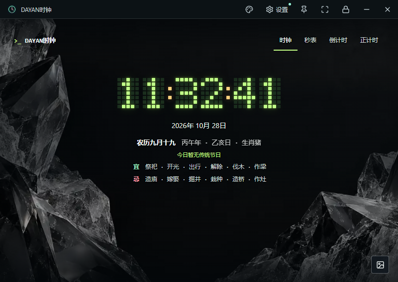

# 桌面验收

## 1.6.1 更新下载链路优化

验证日期：2026-10-28，Windows 11 专业版 x64。源码检查通过，版本为 1.6.1；主进程、预加载脚本和渲染脚本语法检查通过，Git 差异检查无空白错误。

本次新增更新下载连接阶段提示、GitHub Release 资产 API 优先下载、备用地址切换、30 秒连接和分段接收超时，以及中文网络错误提示。GitHub API 与 Release 资产 API 网络探测成功；模拟更新清单在开发模式和打包模式均通过。

开发模式和 `win-unpacked` 程序通过完整桌面回归：设置页四个菜单正常显示；老黄历开关、四种右上角模式文字开关、开机自启动状态和关于我们公司信息可见且可操作；默认进入时钟、默认隐藏“时钟”文字；日期包含星期；原有窗口缩放、14 种样式、20 张壁纸、四种计时模式、全屏、锁屏密码、单实例和状态持久化均通过，未记录应用脚本错误。

更新流程使用本地模拟 JSON 清单进行打包前后验收：启动后自动检测更高版本，弹出无关闭按钮的更新提示，显示版本和说明，只保留“确定更新”操作。当前 GitHub 仓库和 Release 已公开，普通用户可直接访问默认更新源；本次桌面回归仍使用本地模拟清单，未把在线下载作为自动化验收步骤。更新下载逻辑在主进程执行，并在安装前校验 SHA-256。

最终 Windows NSIS 安装包已重新生成；安装包内主程序与 `win-unpacked` 主程序、`app.asar` 负载应在发布前进行 SHA-256 比对。本次使用独立测试数据和测试密码，没有覆盖当前用户安装目录，也没有修改本机 Windows 策略。

## 1.4.1 十张新增壁纸

验证日期：2026-10-28，Windows 11 专业版 x64。`npm run check` 通过：版本为 1.4.1，20 张壁纸注册项唯一，源文件路径、PNG 签名、清单中的像素尺寸与 SHA-256 均通过检查。

开发模式与 Windows 打包程序均通过壁纸专项检查：20 张图片解码；480、800 像素宽窗口中的背景选择面板保持在窗口内并可滚动到末尾；旧壁纸仍可用；10 张新增壁纸切换不会打断秒表；新增壁纸在原生全屏锁屏中保持显示，锁屏时隐藏控件，密码解锁后恢复窗口；关闭重开后保留新增壁纸选择。完整桌面回归同时通过窗口缩放、四角拖拽、四种计时模式、14 种样式、黄历、全屏标题栏自动隐藏、密码锁定与单实例等检查，未记录应用错误。

最终 NSIS 安装包中提取的 `DAYANClock.exe` 与 `app.asar` 将分别与已测试的 `win-unpacked` 程序进行 SHA-256 比对；安装包中的 20 张壁纸、版本清单和文档随 `app.asar` 一并检查。本次使用独立测试数据和测试密码，没有覆盖用户现有安装目录，也没有修改本机 Windows 策略。

新增 PNG 的实际尺寸均为 1672×941，保留原始字节和校验值；这证明素材已正确集成，不代表原生 4K / 8K 画质。全屏适配检查覆盖布局和图片裁切策略，实体 4K、8K 显示器仍需在目标设备上复验。

## 1.4.0 九款新增样式

验证日期：2026-10-28，Windows 11 专业版 x64。开发模式与 Windows 打包程序均通过六组样式专项检查：旧版设置迁移；十四款样式在 480、800 像素宽原生窗口中的布局；九款画布非空且包含实时数字；秒表运行中逐个切换新增样式、暂停、重置、倒计时归零及正计时；锁屏时隐藏控件并使用密码恢复；关闭重开保留新增样式且默认进入时钟。未记录应用脚本错误。

1080p、4K、8K 和 1080×1920 竖屏检查通过 Chromium 视口模拟完成，检查所有新增画布的边界与像素预算；不代表这些规格的实体显示器均已实机测试。九款普通窗口截图已逐一查看，README 提供三款真实程序截图。

开发模式及打包程序另通过原有十组桌面回归，涵盖窗口缩放、设置检测、四种计时模式、全屏、锁屏解锁、单实例与关闭后恢复。最终 NSIS 安装包中提取的主程序和 app.asar，其 SHA-256 分别与上述已测试程序一致；本次未在用户现有安装目录执行覆盖安装。

本次使用独立测试数据和测试密码，不修改现有用户设置或 Windows 策略。Windows 安装包版本为 1.4.0，包含新增样式代码与本地素材。

## 1.3.2 窗口恢复回归

验证日期：2026-10-28，Windows 11 专业版 x64。先在修复前复现：从普通窗口锁屏后解锁，原 800×568 窗口错误恢复为 3440×1440，页面两侧各留出约 706 像素。

修复后，独立测试数据中的普通窗口在锁屏解锁、连续三次全屏切换及全屏最小化恢复、普通窗口最小化恢复后，均恢复原位置与尺寸；页面与实际客户区边缘重合。另验证已经全屏时再锁屏，以及 480、1200 像素宽窗口的锁定解锁。验证检查窗口尺寸、视口、页面边界和保存的普通窗口记录，而非仅确认全屏标志。

开发模式与 `win-unpacked` 程序的十组完整桌面回归通过，无应用错误。窗口恢复专项同时在打包程序及从最终 NSIS 安装包提取的程序上通过。本次检查使用独立用户数据目录，不修改本机 Windows 策略。

以下为修复后使用赛博终端样式、冰晶壁纸的普通窗口截图，壁纸与标题栏均到达窗口左右边缘：

## 1.3.1 已有验证记录

验证日期：2026-10-28。实机为 Windows 11 专业版 x64。开发模式、`win-unpacked` 程序及从 NSIS 安装包提取的实际程序完成桌面自动化检查。安装包提取测试验证程序负载，不等于在所有系统上完整执行安装向导。

通过的十组检查包括：窗口边界计算与四角缩放；首次设置与真实系统只读检测；默认时钟与隔离渲染；十张壁纸解码和五种样式；正计时/暂停/秒表/倒计时；原生边界比例；全屏与顶部栏隐藏；密码哈希与锁定/解锁；单实例；关闭后的状态恢复。记录中无应用错误。

另有四组设置检查：已有密码的升级入口；检测失败与未验证未来版本提示；模拟 UAC 取消、授权完成和策略恢复；设置入口与既有密码保留。

系统版本与策略读取使用真实 Windows 环境。UAC 成功、取消、恢复等分支使用 IPC 模拟，**没有实际写入或恢复本机系统策略**。Windows 10、macOS 和所有显示器组合未完成实机验收；不能据此宣称能拦截 Windows 安全桌面。

上述原始自动化脚本属于本次本地验收环境，未作为可移植测试套件交付。仓库提供可移植 `npm run check` 与以下人工桌面清单，维护者应在目标平台复验。

## 维护时检查

- `npm ci` 后执行 `npm run check`，确认版本、资源、文档和语法无误。
- 首次启动默认时钟，显示真实本地时间、年月日和黄历；设置能显示版本、架构与五项策略。
- 逐个切换十四种样式与二十张壁纸，末位数字完整，无图片丢失；最小窗口中能滚动到最后一张并保存选择。
- 检查秒表、正计时、倒计时的启动、暂停、重置与倒计时归零；切换样式和时钟不打断后台计时。
- 从最小窗口拖动四角，再全屏；在横屏、竖屏和不同缩放比例上确认数字、黄历和按钮没有裁切。
- 全屏停止移动鼠标后顶部栏隐藏，移动后显示；退出全屏后恢复原窗口。
- 连续三次全屏、最小化恢复、退出全屏；再从普通窗口锁屏并解锁，确认普通窗口原位置和大小恢复、背景无两侧黑边。
- 设置数字密码，从普通窗口点击锁定后应铺满所在屏幕；操作控件隐藏，仅可从锁按钮验证密码恢复。
- 错误密码不能解锁，正确密码加回车可以解锁；原密码仍可用于修改密码。
- 再次启动只保留一个窗口；关闭再打开保留样式、目标时间和窗口设置，默认仍进入时钟。
- 在专用测试用户中执行实际 UAC 授权、重新登录与恢复，保留原策略备份，核对是否被组织组策略覆盖。
- 对正式安装包重复主要流程，记录软件版本、系统版本、分辨率、缩放比例、通过项与未验证项。
