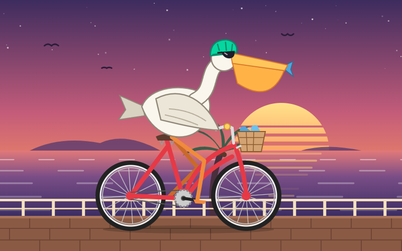
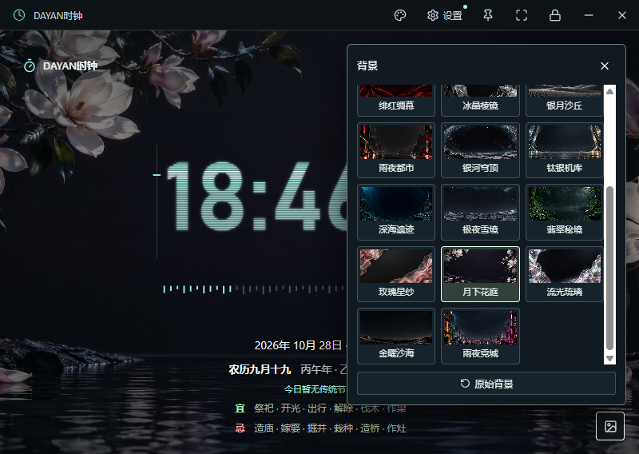

# 壁纸素材说明

## 原创骑行动画

1.6.22 在背景选择器中新增“动态背景”分类，提供两款本地 SVG 动画：

用户提供的 HTML 保存在 `assets/backgrounds/dynamic/originals/`，内容逐字节保留，SHA-256 记录于 `originals.json`。外层适配文件只隐藏演示页标题、控件和卡片边框，动画 SVG、脚本、颜色、元素及默认速度保持原样。
画面通过外层容器按 `cover` 等比例铺满每块显示器：以宽高两个缩放比例中的较大者为准，超出屏幕的边缘居中裁切，不拉伸角色，也不在两侧保留演示页底色。原始 SVG、动画脚本和播放速度不变，窗口尺寸变化时只调整容器，不重新加载动画。全部显示器模式按系统屏幕坐标分别铺设，时钟内容仍限于主屏。

`npm run test:dynamic-backgrounds` 比较原版与嵌入版在固定时刻的完整 SVG，复核运动持续、预览、选择保存、横屏/竖屏/超宽屏的实际画面覆盖以及多屏坐标。

## 背景接入要求（所有后续背景适用）

- 静态图片、视频和 HTML 动画必须兼容单屏全屏及同一主机的多屏全屏；不能只在设计稿比例或小窗口中验收。
- 每块显示器独立铺满背景，默认等比例 `cover`，允许裁切边缘，禁止拉伸、柱状留白或按整个虚拟桌面做一次缩放。静态图片、视频和 HTML 均自动使用统一的逐屏容器，无需在素材注册中额外声明多屏支持。
- HTML 中存在固定比例 SVG、Canvas 或场景容器时，必须在该页面的适配层实现铺满；仅把 iframe 设置为 100% 不代表内部画面铺满。保留原始动画要求时，应调整外层容器，保持原始文件和脚本不变。
- 显示器坐标以系统提供的逻辑坐标为准，支持副屏位于主屏左侧、上方、横竖屏混排、不同分辨率及不同缩放比例；切换背景、连接或移除显示器后重新计算，时钟、日期、农历及黄历仍只在主屏。
- 验收至少覆盖 4:3、16:9、16:10、21:9、32:9、竖屏、单屏与多屏组合。检查场景真实绘制范围及截图边缘，不得只检查 iframe 或 SVG 元素的宽高；同时检查动画持续播放、原始比例和选择持久化。
- 新增背景时运行 `npm run check` 和 `npm run test:dynamic-backgrounds`；涉及安装资源时对打包后的程序再运行动态背景验收。模拟布局验收和实体多显示器实测需要分别记录。

## 静态背景

1.4.1 将新生成的十个主题加入右下角背景选择面板，连同原有十张共二十张。所有文件随安装包提供，断网可用，选择会自动保存。面板高度随窗口约束，缩略图列表可滚动。

| 新主题 | 风格 | 原图 |
| --- | --- | --- |
| 银河穹顶 | 星际科幻 | [PNG](../assets/backgrounds/galactic-vault.png) |
| 钛银机库 | 硬朗科幻 | [PNG](../assets/backgrounds/titanium-hangar.png) |
| 深海遗迹 | 深海秘境 | [PNG](../assets/backgrounds/abyssal-sanctuary.png) |
| 极夜雪境 | 自然极简 | [PNG](../assets/backgrounds/polar-silence.png) |
| 翡翠秘境 | 自然疗愈 | [PNG](../assets/backgrounds/emerald-sanctuary.png) |
| 玫瑰星纱 | 柔和时尚 | [PNG](../assets/backgrounds/rose-silk.png) |
| 月下花庭 | 柔和花卉 | [PNG](../assets/backgrounds/moonlit-garden.png) |
| 流光琉璃 | 轻盈未来 | [PNG](../assets/backgrounds/prismatic-glass.png) |
| 金曜沙海 | 静奢极简 | [PNG](../assets/backgrounds/obsidian-dunes.png) |
| 雨夜霓城 | 都市赛博 | [PNG](../assets/backgrounds/neon-rain.png) |

## 画质与适配

新增十张使用内置 image_gen 于 2026-10-28 生成，原图全部为 **1672×941 像素**。请求过 3840×2160，接口实际返回较低尺寸；这批文件未进行放大、重采样或有损转换，保留生成结果的原始 PNG 字节。

背景使用 `cover` 居中等比例铺满。16:9、16:10、21:9 和竖屏会按窗口比例裁切部分画面。中央保留深色读时区，景物细节主要分布在四周。

22 至 50 英寸表示物理尺寸，不能直接决定图片清晰度。新增图片低于 1920×1080，在 4K / 8K 显示器全屏时会放大，**不应宣传为原生 4K / 8K 高清壁纸**。程序的高分辨率布局适配不代表原图新增了细节像素。

## 维护与校验

[素材清单](../assets/backgrounds-20261028.json) 记录主题、路径、实际尺寸、文件字节数和 SHA-256；[生成提示词](wallpaper-prompts.md) 记录共同构图规范与各主题描述。

`npm run check` 检查二十张壁纸的存在性与文件类型，并复核新增十张的注册路径、尺寸和原图 SHA-256。新增或替换图片时，应同时维护 `renderer/backgrounds.js`、素材清单、README 图文和更新记录。更高分辨率文件应作为后续独立更新记录，不修改这批原始素材的尺寸声明。
