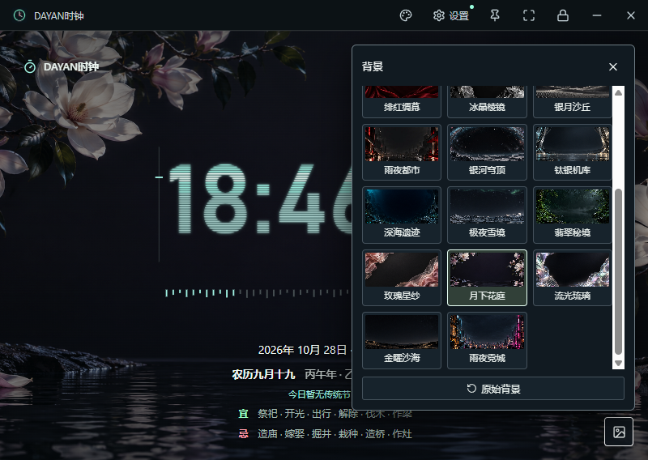

# 壁纸素材说明

## 原创骑行动画

1.6.22 在背景选择器中新增“动态背景”分类，提供两款本地 SVG 动画：

用户提供的 HTML 保存在 `assets/backgrounds/dynamic/originals/`，内容逐字节保留，SHA-256 记录于 `originals.json`。外层适配文件只隐藏演示页标题、控件和卡片边框，动画 SVG、脚本、颜色、元素及默认速度保持原样。
画面完整保留原始 800:500 场景，按 `contain` 等比例缩放，不裁切鹈鹕、太阳、车轮或道路。新增的场景延展层补齐额外的天空、山丘、云朵、道路，海边版本补齐海面、波纹、棕榈树、栏杆及栈道；每块显示器都铺满实际景物，没有两侧底色。延展景物引用原始动画节点，路面和波纹同步原有相位。原始 SVG、动画脚本和播放速度不变，窗口尺寸变化时只调整容器及补景范围，不重新加载动画。全部显示器模式按系统屏幕坐标分别铺设，时钟内容仍限于主屏。

`npm run test:dynamic-backgrounds` 比较原版与嵌入版在固定时刻的完整 SVG，复核运动持续、预览、选择保存、横屏/竖屏/超宽屏的实际画面覆盖以及多屏坐标。

## 背景接入要求（所有后续背景适用）

- 静态图片、视频和 HTML 动画必须兼容单屏全屏及同一主机的多屏全屏；不能只在设计稿比例或小窗口中验收。
- 每块显示器独立铺满背景，同时保留完整主体与构图，不得用裁切或拉伸掩盖适配缺失，也不得留下柱状空白。代码动画应等比例完整呈现原场景，并补齐额外的天空、地面及环境。静态图和视频新增接入时也必须评估主体完整性，当前通用媒体层的 `cover` 默认值不代表允许新增素材裁掉主体。静态图片、视频和 HTML 均自动使用统一的逐屏容器，无需在素材注册中额外声明多屏支持。
- HTML 中存在固定比例 SVG、Canvas 或场景容器时，必须在该页面的适配层实现铺满；仅把 iframe 设置为 100% 不代表内部画面铺满。保留原始动画要求时，应调整外层容器，保持原始文件和脚本不变。
- Canvas 的绘图缓冲区必须匹配实际视口比例，原始场景按同一倍率完整缩放，剩余空间延展真实场景；禁止仅用 CSS `fill` 非等比拉伸，也禁止 `contain` 后不补景。小狐背景横向延展山丘、松树和地面，竖向延展星空，游戏逻辑、镜头和角色仍保留原有坐标。
- 背景切换必须测试独立托盘菜单与主窗口双向同步：先在主窗口选择末项，菜单切到其他背景，再切回；全目录正序、倒序重复至少两轮，关闭并重开菜单后再切换。必须同时核对选中标记、实际媒体地址、所有样式的保存状态；只验证保存成功、缩略图高亮或直接调用主窗口按钮均不算通过。验收目录自动读取 `renderer/backgrounds.js`，新增素材不得遗漏。
- 跨窗口状态去重必须记录最新已应用的状态，不能永久拿本窗口上次写出的旧状态当基准。该错误曾导致末项小狐背景及海边骑行切回无反应，属于所有背景共享链路的回归风险。
- 显示器坐标以系统提供的逻辑坐标为准，支持副屏位于主屏左侧、上方、横竖屏混排、不同分辨率及不同缩放比例；切换背景、连接或移除显示器后重新计算，时钟、日期、农历及黄历仍只在主屏。
- 验收至少覆盖 4:3、16:9、16:10、21:9、32:9、竖屏、单屏与多屏组合。检查场景真实绘制范围、截图边缘及完整主体（至少包括头部、喙、车轮和太阳），不得只检查 iframe 或 SVG 元素的宽高；同时检查动画持续播放、原始比例和选择持久化。
- 新增背景时运行 `npm run check` 和 `npm run test:dynamic-backgrounds`；涉及安装资源时对打包后的程序再运行动态背景验收。模拟布局验收和实体多显示器实测需要分别记录。

## 长期运行与闪屏排查

同一背景按显示器 ID 保留媒体节点。显示器列表重排和尺寸变化只更新位置、大小，不重新设置媒体地址，也不移动仍在使用的 iframe；断开显示器只移除对应节点，连接新屏幕只创建新节点。全屏时忽略仅 `workArea` 变化的通知，分辨率、缩放和旋转变化仍重新适配 Windows 桌面。

运行 `npm run test:wallpaper-stability` 验证所有 HTML 背景的页面复用、断开重连、任务栏工作区通知以及短时持续运行。`DAYAN_SOAK_SECONDS` 可以延长实际运行时间；`--packaged` 验证打包程序。测试按显示器采样渲染结果，不能证明数小时运行或显示合成器的每一帧都不闪屏。

应用在用户数据目录的 `diagnostics/render-events.jsonl` 记录显卡进程异常、渲染进程退出/无响应、页面导航、显示配置及休眠恢复事件。日志只保留当前文件及一个轮转文件，每个约 128 KiB，不记录密码、密保、页面内容或完整本地路径。无法写入日志时不影响桌面运行。白闪若仅在长期真实使用时发生，应对照发生时间取证，不能仅凭短时回归宣布完全解决。

## 静态背景

1.4.1 将新生成的十个主题加入右下角背景选择面板，连同原有十张共二十张。所有文件随安装包提供，断网可用，选择会自动保存。面板高度随窗口约束，缩略图列表可滚动。

| 新主题 | 风格 | 原图 |
| --- | --- | --- |
| 银河穹顶 | 星际科幻 | [PNG](../assets/backgrounds/galactic-vault.png) |
| 钛银机库 | 硬朗科幻 | [PNG](../assets/backgrounds/titanium-hangar.png) |
| 深海遗迹 | 深海秘境 | [PNG](../assets/backgrounds/abyssal-sanctuary.png) |
| 极夜雪境 | 自然极简 | [PNG](../assets/backgrounds/polar-silence.png) |
| 翡翠秘境 | 自然疗愈 | [PNG](../assets/backgrounds/emerald-sanctuary.png) |
| 玫瑰星纱 | 柔和时尚 | [PNG](../assets/backgrounds/rose-silk.png) |
| 月下花庭 | 柔和花卉 | [PNG](../assets/backgrounds/moonlit-garden.png) |
| 流光琉璃 | 轻盈未来 | [PNG](../assets/backgrounds/prismatic-glass.png) |
| 金曜沙海 | 静奢极简 | [PNG](../assets/backgrounds/obsidian-dunes.png) |
| 雨夜霓城 | 都市赛博 | [PNG](../assets/backgrounds/neon-rain.png) |

## 画质与适配

新增十张使用内置 image_gen 于 2026-10-28 生成，原图全部为 **1672×941 像素**。请求过 3840×2160，接口实际返回较低尺寸；这批文件未进行放大、重采样或有损转换，保留生成结果的原始 PNG 字节。

背景使用 `cover` 居中等比例铺满。16:9、16:10、21:9 和竖屏会按窗口比例裁切部分画面。中央保留深色读时区，景物细节主要分布在四周。

22 至 50 英寸表示物理尺寸，不能直接决定图片清晰度。新增图片低于 1920×1080，在 4K / 8K 显示器全屏时会放大，**不应宣传为原生 4K / 8K 高清壁纸**。程序的高分辨率布局适配不代表原图新增了细节像素。

## 维护与校验

[素材清单](../assets/backgrounds-20261028.json) 记录主题、路径、实际尺寸、文件字节数和 SHA-256；[生成提示词](wallpaper-prompts.md) 记录共同构图规范与各主题描述。

`npm run check` 检查二十张壁纸的存在性与文件类型，并复核新增十张的注册路径、尺寸和原图 SHA-256。新增或替换图片时，应同时维护 `renderer/backgrounds.js`、素材清单、README 图文和更新记录。更高分辨率文件应作为后续独立更新记录，不修改这批原始素材的尺寸声明。

## 3D 海岛骑行 · 昼夜相伴

在“动态背景”中新增“海岛骑行 · 昼夜相伴”。原始岛屿、海面、建筑、植被、骑车角色与动作保存在 originals/pelican_island_3d.html，逐字节保留并登记 SHA-256。专用版随软件携带 Three.js r170，无需联网；没有声音、演示控制面板或第一人称镜头。

光照按系统本地时间连续计算，调整系统时间或休眠恢复后同步。镜头按本地时间协调循环：跟随 4 分钟、侧面 4 分钟、环绕 5 分钟、全景 3 分钟；换镜头用 8 秒平滑过渡。近景换镜头后挥手并短暂慢动作，随后自动恢复正常骑行。竖屏使用相应透视视野和机位，不拉伸、不裁主体；原有 3D 世界直接延展铺满每块显示器。

08:00–10:00、12:00–14:00、17:00–19:00、22:00–次日 02:00，在近景显示一次简短问候，约 10 秒自动消失，同一时段至少间隔 16 分钟。内容对应早安、午休、下班陪伴家人及夜间休息，不播放音效，也不读取或截获桌面的点击、键盘或文字。全景不显示气泡；多屏只允许主屏显示气泡，副屏继续播放场景。更改主屏时更新上下文，不重新载入动画。

画面默认最高约 30 帧/秒，每屏绘图预算 180 万像素，按持续渲染耗时降低分辨率与泛光。页面隐藏时暂停，恢复时同步本地时间；WebGL 上下文丢失时等待恢复，不使用定时刷新。环境反射先生成并切换到新贴图，再释放旧贴图，避免引用已释放资源。

构建：先在工作目录外安装 three@0.170.0 与 esbuild@0.25.12，设置 DAYAN_ISLAND_BUILD_DEPS 指向该构建依赖目录，再运行 node tools/build-island-wallpaper.cjs。输出为本地经典脚本 derived/island.bundle.js、许可证和构建版本记录。island-director.js 负责时间段与镜头节奏，island-runtime.js 负责镜头、动作、气泡及生命周期；修改后重新构建，不能只改源文件而漏掉 bundle。

单独运行 node tools/check-island-wallpaper.cjs，验证断网加载、静音、本地时段、四种机位、完整角色投影、真实截图像素和 8 种屏幕比例。该检查也已加入 test:dynamic-backgrounds，连同整个目录的托盘/主窗口切换及打包资源一致性检查一起执行。模拟屏幕布局不能替代所有实体显示器验收。
