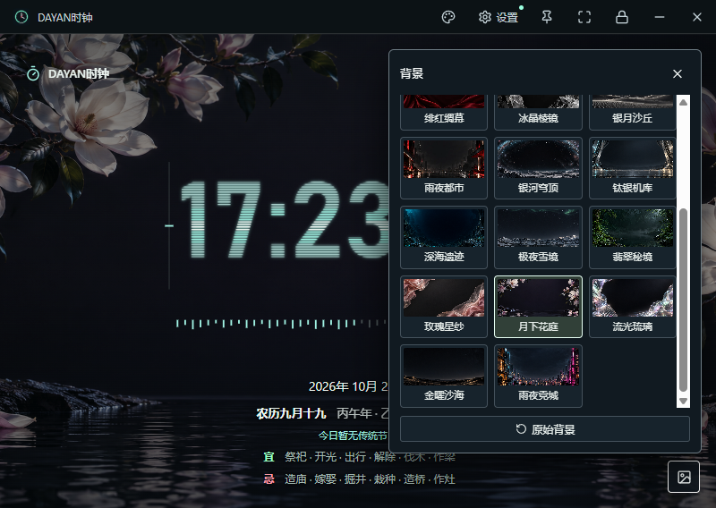

# 壁纸素材说明

1.4.1 将新生成的十个主题加入右下角背景选择面板，连同原有十张共二十张。所有文件随安装包提供，断网可用，选择会自动保存。面板高度随窗口约束，缩略图列表可滚动。

| 新主题 | 风格 | 原图 |
| --- | --- | --- |
| 银河穹顶 | 星际科幻 | [PNG](../assets/backgrounds/galactic-vault.png) |
| 钛银机库 | 硬朗科幻 | [PNG](../assets/backgrounds/titanium-hangar.png) |
| 深海遗迹 | 深海秘境 | [PNG](../assets/backgrounds/abyssal-sanctuary.png) |
| 极夜雪境 | 自然极简 | [PNG](../assets/backgrounds/polar-silence.png) |
| 翡翠秘境 | 自然疗愈 | [PNG](../assets/backgrounds/emerald-sanctuary.png) |
| 玫瑰星纱 | 柔和时尚 | [PNG](../assets/backgrounds/rose-silk.png) |
| 月下花庭 | 柔和花卉 | [PNG](../assets/backgrounds/moonlit-garden.png) |
| 流光琉璃 | 轻盈未来 | [PNG](../assets/backgrounds/prismatic-glass.png) |
| 金曜沙海 | 静奢极简 | [PNG](../assets/backgrounds/obsidian-dunes.png) |
| 雨夜霓城 | 都市赛博 | [PNG](../assets/backgrounds/neon-rain.png) |

## 画质与适配

新增十张使用内置 image_gen 于 2026-10-28 生成，原图全部为 **1672×941 像素**。请求过 3840×2160，接口实际返回较低尺寸；这批文件未进行放大、重采样或有损转换，保留生成结果的原始 PNG 字节。

背景使用 `cover` 居中等比例铺满。16:9、16:10、21:9 和竖屏会按窗口比例裁切部分画面。中央保留深色读时区，景物细节主要分布在四周。

22 至 50 英寸表示物理尺寸，不能直接决定图片清晰度。新增图片低于 1920×1080，在 4K / 8K 显示器全屏时会放大，**不应宣传为原生 4K / 8K 高清壁纸**。程序的高分辨率布局适配不代表原图新增了细节像素。

## 维护与校验

[素材清单](../assets/backgrounds-20261028.json) 记录主题、路径、实际尺寸、文件字节数和 SHA-256；[生成提示词](wallpaper-prompts.md) 记录共同构图规范与各主题描述。

`npm run check` 检查二十张壁纸的存在性与文件类型，并复核新增十张的注册路径、尺寸和原图 SHA-256。新增或替换图片时，应同时维护 `renderer/backgrounds.js`、素材清单、README 图文和更新记录。更高分辨率文件应作为后续独立更新记录，不修改这批原始素材的尺寸声明。
